# Языки программирования
## Лабораторная работа 10

### Задание 1 **(2)**

*Рассмотрите следующие фрагменты программ. Запишите, что означают символы* **&** и  * *в каждом случае применения.*
```
int a = 10, b = 20;
int *p = &a , *q = &b;
p = q;
std::cout << *p <<' '<< *q << std::endl;
```
* int *p, *q  * является частью объявления типа
   p и q это указатели на int
* В &a и &b символ **&** это операция взятия адреса,  p получает адрес переменной a, а q адрес переменной b
* В строке p = q происходит присваивание указателей, теперь оба указателя указывают на переменную b
* В cout *p и *q выводится значение, которое находится по адресу хранщемуся в указателе

```
int a = 10, b = 20;
int *p = &a , *q = &b;
*p = *q;
std::cout << *p <<' '<< *q << std::endl;
```
* int *p, *q  * является частью объявления типа
   p и q это указатели на int
* В &a и &b символ **&** это операция взятия адреса,  p получает адрес переменной a, а q адрес переменной b
* В строке *p = *q, * означает разыменование, значение по адресу q т.е. значение b копируется в переменную на которую указывает p т.е. в a.
* p также указывает на a, а q на b

*Чем различаются присваивания в третьей строке? Что можно вывести,
чтобы показать различия?*

в первом случае меняется адрес, который хранится в указателе, а во втором случае меняется значение переменной по адресу

Чтобы показать различия нужно вывести сами переменные a и b, адреса &a и &b и знач-я указателей p и q
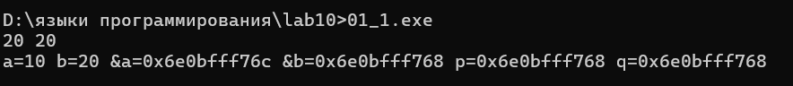
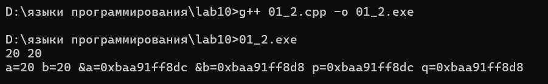
*Примеры программ сохраните в папке с номером задания. Скриншоты работы прикрепите к отчету.*
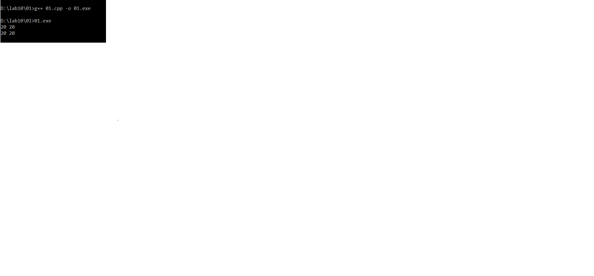

### Задание 2 **(1)**

*Рассмотрим следующую программу.* 
```
double x[10];
for (int i = 0; i <10; i++)
    std::cout << &x[i] << std::endl;
```
*Что она выводит? Измените
вывод так, чтобы адреса выводились в десятичной системе счисления.
Объясните почему числа составляют арифметическую прогрессию с
определенным шагом.*
* Каждый элемент типа double занимает одинаковое число байт

* Т.е каждый следующий адрес больше на 8 байт. поэтому последовательность арифметическая прогрессия
*Записанную программу сохраните в папке с номером задания.*
*Скриншоты работы прикрепите к отчету.*

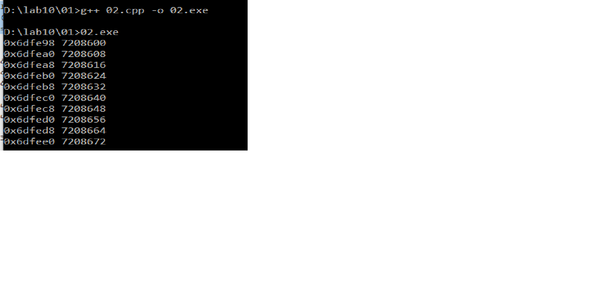

### Задание 3 **(2)**

*Токен* **«*»** *в языке C++ может использоваться в трех различных
случаях. Аналогично токен* **«&»** *также может использоваться в трех
случаях. Приведите пример одной программы в которой они были бы
использованы во всех случаях.*
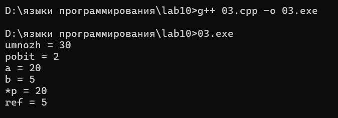
*Записанную программу сохраните в папке с номером задания.*

### Задание 4 **(2)**

*Выпишите значения всех переменных, в том числе указателей,
после выполнения каждой инструкции программы. Объясните, что
происходит в результате выполнения каждой инструкции.*
```
unsigned a = 8, b = 3 ,c = 17;
unsigned *p = &a;
unsigned *q = &b;
*p += *q + c;
c = *q;
p = &c;
c += a;
*p += 10;
*q = *p;
q = p ;
*q += 10;
```
1. a=8,   b=3,  c=17
2. a=8,   b=3,  c=17, p=&a, *p=8
3. a=8,   b=3,  c=17, p=&a, q=&b, *p=8, *q=3
4. a=28,   b=3,  c=17, p=&a, q=&b, *p=28, *q=3
5. a=28,   b=3,  c=3,  p=&a, q=&b, *p=28, *q=3
6. a=28,   b=3,  c=3, p=&c,  q=&b, *p=3, *q=3
7. a=28,   b=3,  c=31, p=&c,  q=&b, *p=31, *q=3
8. a=28,   b=3,  c=41, p=&c,  q=&b, *p=41, *q=3
9. a=28,   b=41,  c=41, p=&c,  q=&b, *p=41, *q=41
10. a=28,   b=41,  c=41, p=&c,  q=&c, *p=41, *q=41
11. a=28,   b=41,  c=51, p=&c,  q=&c, *p=51, *q=51

1. Объявляются переменные
2. Объявляется указатель p и в него записывается адрес переменной a(8)
3. Объявляется указатель q, в него записывается адрес b(3)
4. *p это a = 8, *q это b = 3, c = 17 **a = 8 + (3 + 17) = 28**
5. *q  это значение b = 3 отсюда c = 3
6. Указатель p теперь хранит адрес переменной c
7. c = c + a = 3 + 28 = 31
8. *p это c отсюда c = c + 10 = 31 + 10 = 41
9. *q  это b, *p это c = 41.Значит b = 41. Переменная c остаётся равной 41
10. Указатель q теперь указывает на c
11. *q это c, т.к q указывает на c.Значит, c = c + 10 = 41 + 10 = 51

### Задание 5 **(1)**

*Что сравнивается в приведенной ниже программе? Как можно
изменить первую строчку программы, чтобы результат тоже
изменился?*
```
int x = 1, y = 2;
int *p = &y, *q = &x;
if (p < q)
    std::cout << "Yes";
else
    std::cout << "No";
```
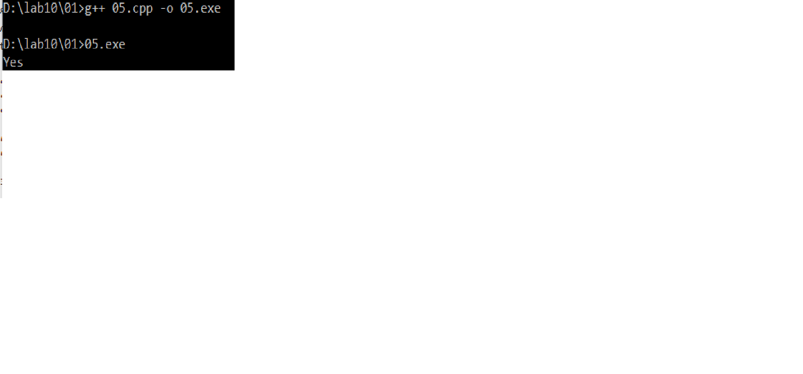
* сравниваются адреса котлрые хранятся в указателях
* Чтобы результат изменился нужно поменять порядок объявления переменных
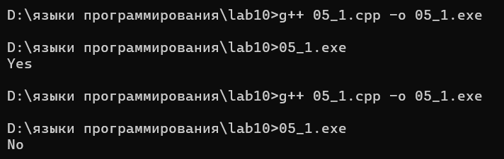

### Задание 6 **(2)**

*Объясните работу следующей программы. Как изменится
результат, если тип* **double** *изменить на некоторый другой, например*
**int** *или* **char**?
```
double x = 0;
double *d = &x;
std::cout << reinterpret_cast<size_t>(d + 4) - reinterpret_cast<size_t>(d - 4) << std::endl;
```
* Объявляется переменная x типа double со значением 0
* Объявляется указатель d типа double в который записывается адрес переменной x
* Вычисляются два выражения это d + 4 указатель сдвинутый от d на 4 элемента вперёд и d - 4 указатель сдвнутый 4 элемента назад
* каждый из указателей преобразуется к целому числу size_t с помощью reinterpret_cast<size_t>
* программа выводит разность адресов в байтах
  
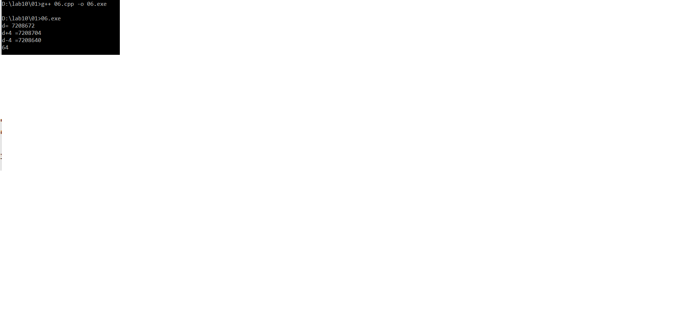
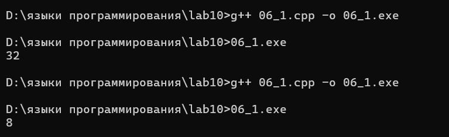
*  Результат меняется именно из-за изменения размера элемента на который указывает указатель
### Задание 7 **(2)**

*Объясните работу следующей программы. Как изменится
результат, если тип* **double** *изменить на некоторый другой, например*
**int** *или* **char**?
```
std::cout << reinterpret_cast <double*>(3000) - reinterpret_cast <double*>(2000) << std::endl;
```
* целые числа 3000 и 2000 преобразуются в указатели типа double*
* первый указатель как бы хранит адрес 3000, а второй адрес 2000
* При вычитании указателей одного типа результат считается не в бавйтах, а в кол-ве элементов того типа на котлрый они указывают. Для double* один элемент это sizeof(double) байт
*  разность адресов в байтах равна 3000 - 2000 = 1000 байт
* Если sizeof(double) = 8 то кол-во эл-ов double между этими адресами 1000/8=125

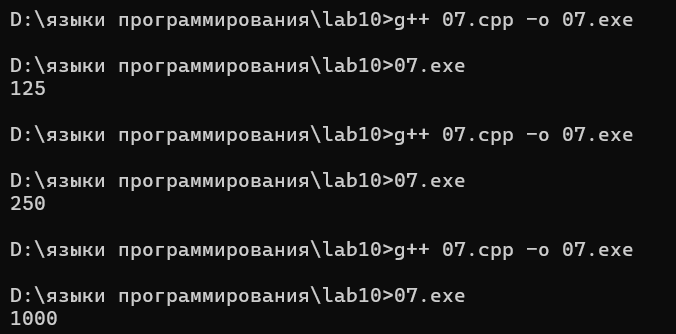
### Задание 8 **(2)**

*Что надо дописать в записанной ниже программе вместо многоточий, чтобы
она выводила все числа из массива* **a**? *Почему?*
```
int a[20];
for ( int i = 0; i < 20; i++)
    a[i] = i;
int *b=a + 8;
for (int i =...; i <...; i++)
    std::cout << b[i] <<' ';
```

```
int a[20];
for ( int i = 0; i < 20; i++)
    a[i] = i;
int *b=a + 8;
for (int i =-8; i <12; i++)
    std::cout << b[i] <<' ';
```
* Т.к b = a + 8 то  b[i] == *(a + 8 + i) == a[8 + i]
* Чтобы вывести a[0] **8 + i = 0  =>  i = -8**
* Чтобы вывести a[19] **8 + i = 19  =>  i = 11**
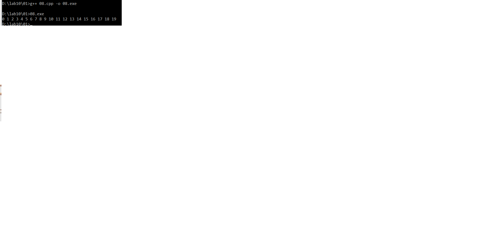

### Задание 9 **(2)**

*Что выводит следующая программа? Изменится ли результат если
изменить тип элементов массива?*

```
int a[10];
std::cout << &a[8] - &a[3] << std::endl;
```
* арифметика указателей и разность указателей измеряются в эл-х того типа на который указывfает указатель. Если между 2мя адресами лежит 5 элементов то разность будет 5
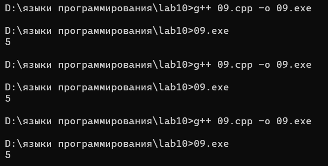

### Задание 10 **(1)**

*Есть ли разница между инициализацией* **p** и **q** *в следующей программе? Обоснуйте ответ.*
```
int x [10]={1, 2, 3, 4, 5, 6, 7, 8, 9, 10};
int *p = x + 5;
int *q = &x[5];
```
* разницы в результате нет
* В выражении x + 5 имя массива x подвергается преобразованию к указателю на первый элемент, т.е. x в выражении становится указателем типа int* на x[0]
* x + 5 = &x[0] + 5 == &x[5]
### Задание 11 **(3)**

*Указатели можно использовать для итерации по массивам.
Напишите программу, которая найдет сумму элементов массива,
используя указатели. В начале цикла указатель требуется установить
на начало массива, в конце каждой итерации смещать его к
следующему элементу массива через инкремент. Для выхода из цикла
надо проверять, что указатель дошел до конца массива.*
```
int x [10]={1, 2, 3, 4, 5, 6, 7, 8, 9, 10};
int s = 0;
for (int *p = ...; ...; ...)
    s += ...
std::cout << s;
```
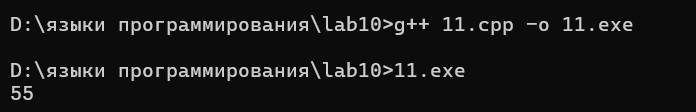
*Записанную программу сохраните в папке с номером задания.*

