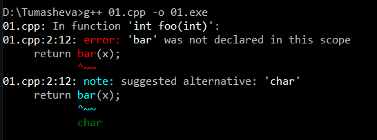
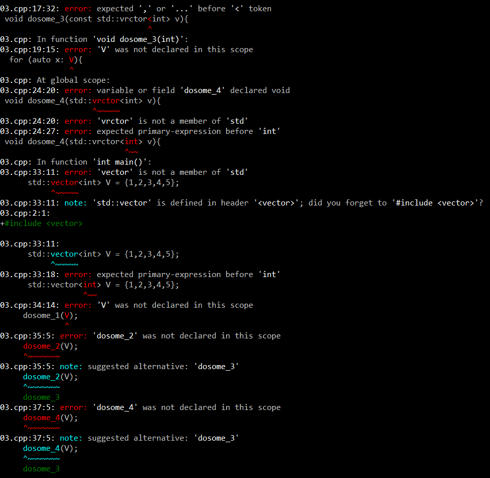
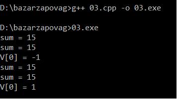
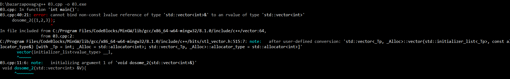

# Языки программирования
## Лабораторная работа 11

### Задание 1 **(2)**

*Что надо дописать в приведенный пример программы, чтобы она транслировалась без ошибок?
Существующий код нельзя изменять или переставлять.*

```
int foo(int x) {
    return bar(x);
}
int bar(int x) {
    return x+1;
}
int main() {
    foo(0);
    return 0;
}
```
```
int bar(int);
int foo(int x) {
    return bar(x);
}
int bar(int x) {
    return x+1;
}
int main() {
    foo(0);
    return 0;
}
```

### Задание 2 **(1)**

*Функция* **dswap** *должна была обменивать значения своих параметров.* 
*(На выводе должно было получиться* ```3.4 1.5```.)
*В чем ошибка при написании этой функции? Как ее исправить? 
Что передавалось в параметры у исходной функции и у исправленной?* 
```
#include <iostream>
void dswap(double x, double y) {
   double t = x;
   x = y;
   y = t;
}
int main(void) {
   double x = 1.5, y = 3.4;
   dswap(x, y);
   std::cout << x << " " << y << std::endl;
   return 0;
}
```

### Задание 3 **(3)**

*Известно, что функция* **dosome** *не изменяет значений вектора* **V**.
*Какие из способов объявления функции является правильным с точки зрения 
корректности работы программы? В чем разница между этими способами?*


```
void dosome_1(const std::vector<int> &V);
void dosome_2(std::vector<int> &V);
void dosome_3(const std::vector<int> V);
void dosome_4(std::vector<int> V);
```


```
#include <iostream>
#include <vector>

void dosome_1(const std::vector<int> &V){
	int s = 0;
	for (auto x: V){
		s+=x;	
    }
    std::cout << "sum = " << s << std::endl;
}
void dosome_2(std::vector<int> &V){
	int s = 0;
	for (auto x: V){
		s+=x;	
    }
    V[0]= -1;
    std::cout << "sum = " << s << std::endl;
}
void dosome_3(const std::vector<int> V){
	int s = 0;
	for (auto x: V){
		s+=x;	
    }
    std::cout << "sum = " << s << std::endl;
}
void dosome_4(std::vector<int> V){
	int s = 0;
	for (auto x: V){
		s+=x;	
    }
    V[0]= -1;
    std::cout << "sum = " << s << std::endl;
}

int main () {
     std::vector<int> V = {1,2,3,4,5};
    dosome_1(V);
    dosome_2(V);
    std::cout << "V[0] = " << V[0] << std::endl;
    V = {1,2,3,4,5};
    dosome_3(V);
    dosome_4(V);
    std::cout << "V[0] = " << V[0] << std::endl;
    return 0;
}
```
*Напишите примеры для этих функций. В качестве примера можно взять нахождение суммы всех элементов
вектора.*

*Выведите адрес нулевого элемента вектора в функции. Объясните результат.*

*Проверьте в какие из этих функций можно передать константные вектора. Объясните результат.*
```
dosome({1, 2, 3});
```



### Задание 4 **(2)**

*Напишите программу в которой будет создаваться восемь массивов из 128 целых чисел четырьмя способами,
каждым способом по два массива.
Первые два массива должны быть глобальными, вторые — локальными статическими, третьи — локальными на стеке,
четвертые — локальными в куче. Выведите адреса первого и последнего элемента в каждом массиве.
Сравните, насколько далеко они располагаются друг от друга. Какие выводы можно из этого сделать.*

*В отчет запишите программу и скриншот ее работы.*

### Задание 5 **(2)**

*Приведенная ниже программа вызывает ошибку. Почему?*

*Что будет, если перенести объявление массива выше функции* **foo**?

*Что будет, если объявить массив с использованием ключевого слова* **static**?

*Что будет, если создать массив такого же размера с использованием* **new**?
```
#include <iostream>
int foo() {
    int x[100010001];
    return x[100010000];
}
int main() {
    std::cout << foo();
    return 0;
}
```


### Задание 6 **(3)**

*Запишите следующую программу. Выполните ее трансляцию с нулевым оровнем оптимизации.
Нарисуйте схематично расположение переменных в памяти в момент вызова при \verb*|a=0|. 
Отметьте кадры стека.*

```
#include <iostream>
long long foo(long long a, long long b) {
   if (a == 0) 
      return 0;
   else {
      long long x, y;
      std::cout << "Enter a=" << a << ", b=" << b << std::endl;
      std::cout << "Ptrs " << &a << ' ' << &b <<' '<< &x<<' '<<&y << std::endl;
      x = a * b;
      y = foo(a - 1, b + 1);
      return x + y;
   }
}
int main() {
   foo(5, 5);
   return 0;
}
```

### Задание 7 **(3)**

*Рассмотрите следующую программу. Выполните ее трансляцию, используя  компилятор g++ без
оптимизации (уровень оптимизации 0). Объясните ее работу.*
```
#include <iostream>
double &choose(double &a, bool flg) {
    double pi = 3.14;
    double &r = flg ? pi : a;
    return r;
}

int main(void)
{
    double a = 2.7;
    double &pi = choose(a, true);
    std::cout << pi << std::endl;
    double &e = choose(a, false);
    std::cout << e << std::endl;
    std::cout << pi << std::endl;
    return 0;
}
```

### Задание 8 **(3)**

*Объясните работу приведенной ниже программы.
Какие ошибки в ней имеются? (Виды ошибок смотрите в лекции.)*
```
#include <iostream>
int main() {
    int *p = new int [10];
    int *q = new int [10];
    for (int i = 0; i <= 10; i++)
        p[i] = i;
    q = p;
    delete[] p;
    for (int i = 0; i <= 10; i++)
        std::cout << q[i] <<" ";
    delete[] q;
    return 0;
}
```
